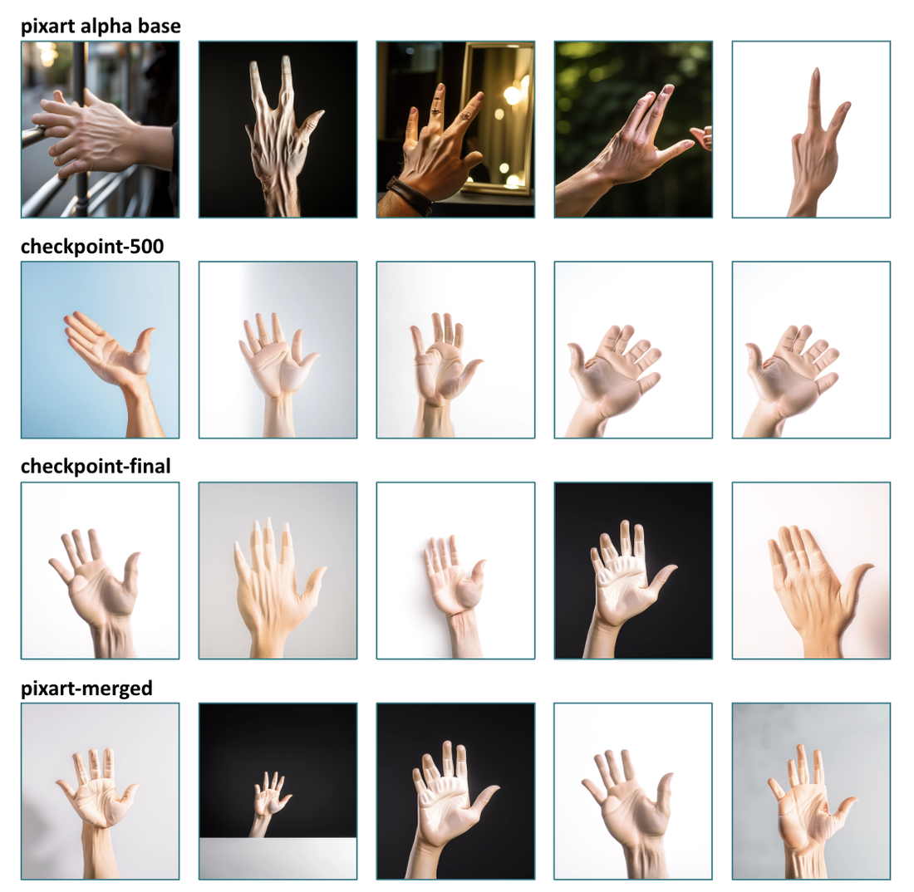

# PixArt-Alpha LoRA: Anatomically Accurate Hand Generation

**LoRA fine-tuning that cuts PixArt-α's FID on hand generation from 126.73 to 109.61 — a 13.5% improvement, training adapters of ~10–50 MB instead of retraining a 26 GB model.**

[](https://github.com/SreenityaThatikunta/PixArt-Alpha-LoRA/actions/workflows/ci.yml)
[](https://youtu.be/Aoez03xao6E)
[](https://huggingface.co/arpita2desh/pixart-hands-lora)
[](LICENSE)



*Top row: PixArt-α base — fused digits, extra fingers, collapsed geometry. Below: our LoRA checkpoints and merged model on the same prompts and seeds.*

Text-to-image diffusion models reliably fail at human hands — extra fingers, fused digits, distorted geometry. PixArt-α is no exception. This project attacks that one failure mode with Low-Rank Adaptation on a curated hand dataset with dense LLaVA-generated captions, keeping the T5 text encoder and VAE frozen and training only adapters on the DiT attention projections.

**Stack:** PyTorch · HuggingFace Diffusers · PEFT (LoRA) · Transformers (T5, LLaVA-Next) · clean-fid · Optuna · Weights & Biases · Gradio

---

## Results

Quantitative evaluation on 3,000 curated hand images, FID computed with `clean-fid` against the held-out real set.

| Model | FID ↓ | Δ vs. base |
|-------|-------|-----------|
| PixArt-α base | 126.73 | — |
| LoRA `checkpoint-500` | 116.41 | **−10.32** (−8.1%) |
| Merged model | **109.61** | **−17.12** (−13.5%) |

**Dataset composition mattered more than hyperparameters.** We held the training set at 3,000 images and varied only its composition:

| Config | Composition | Outcome |
|--------|-------------|---------|
| A | FreiHAND 2,000 + 11K Hands 1,000 | Weakest — in-the-wild occlusion and perspective distortion added noise |
| B | FreiHAND 500 + 11K Hands 2,500 | Intermediate |
| **C** | **11K Hands 3,000** | **Best** — cleaner, more consistent image distribution |

**Qualitative findings:**
- The base model handles general COCO prompts well but consistently malforms hands — the failure is domain-specific, not a general capability gap.
- `checkpoint-500` already shows visible finger separation; the merged model gives the best anatomy across all prompts tested.
- General-domain quality does not regress: COCO-prompt outputs stay sharp after fine-tuning (see `assets/coco_comparison.png`).

**Honest limitation:** FID and T2I-CompBench are not hand-specific metrics. Neither directly measures finger count or joint plausibility, so the anatomical claim rests partly on the qualitative grids above. A hand-landmark detector or a human study would make it rigorous. T2I-CompBench tooling is wired up in `evaluate.py`, but we report no CompBench numbers because we did not complete a full benchmark run.

---

## Quick Start

```bash
git clone https://github.com/SreenityaThatikunta/PixArt-Alpha-LoRA
cd PixArt-Alpha-LoRA
python -m venv .venv && source .venv/bin/activate
pip install -r requirements.txt
cp .env.example .env     # add your W&B / HF tokens if you plan to train or push
```

Then generate images from the published adapter — no training required:

```bash
python generate_images.py --captions captions.json --output_dir generated_images --hf_repo arpita2desh/pixart-hands-lora --checkpoint checkpoint-500 --device cuda:0
```

**Requirements:** Python 3.11+ (the current torch release requires it), a CUDA-capable GPU. Inference needs roughly 12 GB VRAM at 512px; training at 1024px with batch size 2 needs ~24 GB. The base model is a ~26 GB download on first run.

---

## Reproducing the Result

### 1. Dataset

Assembled from [11K Hands](https://sites.google.com/view/11khands) (11,076 images, clean backgrounds, consistent lighting) and [FreiHAND](https://lmb.informatik.uni-freiburg.de/projects/freihand/) (130,240 in-the-wild poses). We select 3,000 images filtered for sharpness and pose diversity — see `dataset.ipynb` for the selection pipeline, including the sharpness scoring and K-means pose clustering.

### 2. Auto-captioning

Raw hand datasets ship without the fine-grained descriptions LoRA needs, so captions are generated with LLaVA-Next (`llava-hf/llava-v1.6-mistral-7b-hf`):

```bash
python generate_captions.py
```

Outputs a JSON file mapping image filenames to dense descriptive captions.

### 3. Training

This is the exact configuration behind the FID numbers above (Config C, 11K Hands only):

```bash
python train.py \
    --data_dir ./hands_dataset \
    --caption_file ./captions.json \
    --output_dir ./lora_hands_output \
    --resolution 512 \
    --num_train_epochs 15 \
    --train_batch_size 2 \
    --gradient_accumulation_steps 4 \
    --learning_rate 5e-6 \
    --lr_scheduler cosine \
    --lr_warmup_steps 200 \
    --lora_rank 16 \
    --lora_alpha 32 \
    --lora_dropout 0.1 \
    --mixed_precision fp16 \
    --use_wandb
```

**Key arguments:**

| Argument | Default | Description |
|----------|---------|-------------|
| `--pretrained_model_name` | `PixArt-alpha/PixArt-XL-2-1024-MS` | Base model |
| `--resolution` | `512` | Image resolution (512 or 1024) |
| `--lora_rank` | `16` | LoRA rank (8–32 typical) |
| `--lora_alpha` | `32` | LoRA scaling factor (we follow α = 2 × rank) |
| `--lora_dropout` | `0.1` | Adapter dropout |
| `--num_train_epochs` | `25` | Training epochs (15 used for the reported run) |
| `--learning_rate` | `5e-6` | Learning rate |
| `--lr_scheduler` | `cosine` | LR schedule (`cosine` or `linear`) |
| `--lr_warmup_steps` | `200` | Warmup steps |
| `--gradient_accumulation_steps` | `4` | Effective batch multiplier |
| `--save_steps` | `500` | Checkpoint save frequency |
| `--merge_weight` | `1.0` | LoRA merge strength (0.0 = base, 1.0 = full) |

**On hyperparameter search:** we ran Optuna, but did not adopt its suggestions directly. It repeatedly proposed rank/alpha pairs that violate the α ≈ 2r convention (e.g. r=4, α=64), which destabilised training. We used Optuna to find sensible *ranges*, then picked clean values manually and fixed rank and alpha by convention.

### 4. Evaluation

```bash
# FID only
python evaluate.py --real_dir images_real --gen_dir images_gen --skip_compbench
```

For T2I-CompBench, clone the benchmark first:

```bash
git clone https://github.com/Karine-Huang/T2I-CompBench.git && pip install -r T2I-CompBench/requirements.txt
```

```bash
python evaluate.py --real_dir images_real --gen_dir images_gen --compbench_dir ./T2I-CompBench --hf_repo arpita2desh/pixart-hands-lora --checkpoint checkpoint-500
```

`generate_samples.py` renders a fixed set of 10 hand prompts across the base model, every saved checkpoint, and the merged model, logging side-by-side grids to W&B.

---

## Architecture

```
┌─────────────────────────────────────────────────────────┐
│                    Training Pipeline                    │
│                                                         │
│  Dataset ──► VAE Encoder ──► Latent Space               │
│                                    │                    │
│  Captions ──► T5 Encoder ──► Text Embeddings            │
│                                    │                    │
│              DDPM Noise ──► Noisy Latents               │
│                                    │                    │
│                    ┌───────────────▼──────────────┐     │
│                    │  PixArt DiT Transformer      │     │
│                    │  ┌────────────────────────┐  │     │
│                    │  │  LoRA Adapters         │  │     │
│                    │  │  (to_q, to_k, to_v,    │  │     │
│                    │  │   to_out.0)            │  │     │
│                    │  └────────────────────────┘  │     │
│                    └───────────────┬──────────────┘     │
│                                    │                    │
│                    Predicted Noise ▼ MSE Loss           │
│                    Optimize LoRA params only            │
└─────────────────────────────────────────────────────────┘

┌─────────────────────────────────────────────────────────┐
│                   Inference Pipeline                    │
│                                                         │
│  Prompt ──► T5 Encoder ──► Text Embeddings              │
│                                    │                    │
│  Random Noise ──► Iterative Denoising (50 steps)        │
│                   with LoRA-enhanced DiT                │
│                                    │                    │
│                    VAE Decoder ──► Generated Image      │
└─────────────────────────────────────────────────────────┘
```

**Key design decisions:**

- **LoRA on attention projections only.** The VAE and T5 text encoder stay frozen; only `to_q`, `to_k`, `to_v`, `to_out.0` in the DiT get adapters. PixArt-α's modular frozen-encoder design isolates the trainable backbone, which makes it unusually well suited to parameter-efficient fine-tuning.
- **Why LoRA over full fine-tuning.** Checkpoints are ~10–50 MB against the full model's ~26 GB, training fits on a single consumer GPU, and the base model's general-domain capability is preserved rather than overwritten.
- **Merging.** `--merge_weight` folds adapters into the base transformer, so the merged model runs standalone without PEFT at inference. We evaluate base, checkpoint, and merged variants as separate pipelines.
- **512px over 1024px for training.** Halving resolution quartered the per-step cost, letting us run the full dataset-composition sweep within our compute budget.

For a deeper walkthrough — noise scheduling, the captioning prompt, sharpness scoring, and the full hyperparameter rationale — see [`TECHNICAL_DEEP_DIVE.md`](TECHNICAL_DEEP_DIVE.md).

---

## Links

| Resource | Link |
|----------|------|
| LoRA weights | [huggingface.co/arpita2desh/pixart-hands-lora](https://huggingface.co/arpita2desh/pixart-hands-lora) |
| Demo video | [youtu.be/Aoez03xao6E](https://youtu.be/Aoez03xao6E) |
| W&B dashboard | [training runs and sample grids](https://wandb.ai/b23cm1007-indian-institute-of-technology-jodhpur/pixart-hands-lora/overview) |
| Report | [`DL_Report.pdf`](DL_Report.pdf) |
| Presentation | [`DL_Presentation_Phase 2.pdf`](DL_Presentation_Phase%202.pdf) |
| Gradio demo | [kaggle-proxy-561j.onrender.com](https://kaggle-proxy-561j.onrender.com) — hosted on a free tier, currently offline |

---

## Project Structure

```
├── train.py                  # LoRA fine-tuning script
├── generate_images.py        # Batch image generation
├── generate_samples.py       # Checkpoint comparison sampling with W&B
├── generate_captions.py      # LLaVA-Next auto-captioning
├── evaluate.py               # FID + T2I-CompBench evaluation
├── dataset.ipynb             # Dataset assembly and filtering
├── Gradio.ipynb              # Interactive demo
├── tests/                    # Test suite
├── assets/                   # README figures
├── TECHNICAL_DEEP_DIVE.md    # Extended technical write-up
├── DL_Report.pdf             # Project report
└── DL_Presentation_Phase 2.pdf  # Project presentation
```

## Development

```bash
pip install -r requirements-dev.txt
pytest
ruff check .
```

Tests covering the dataset pipeline, caption parsing, and CLI contracts skip automatically when the ML stack is not installed, so the layout and hygiene checks run anywhere.

## Team

Arpita Abhijit Deshmukh · Prajna Agrawal · Sreenitya Thatikunta — IIT Jodhpur

## Acknowledgments

- [PixArt-Alpha](https://github.com/PixArt-alpha/PixArt-alpha) — base diffusion model
- [PEFT](https://github.com/huggingface/peft) — parameter-efficient fine-tuning
- [HuggingFace Diffusers](https://github.com/huggingface/diffusers) — diffusion pipeline
- [11K Hands](https://sites.google.com/view/11khands) & [FreiHAND](https://lmb.informatik.uni-freiburg.de/projects/freihand/) — training data
- [T2I-CompBench](https://github.com/Karine-Huang/T2I-CompBench) — evaluation framework

## License

MIT — see [LICENSE](LICENSE). Datasets and the base model carry their own terms.
